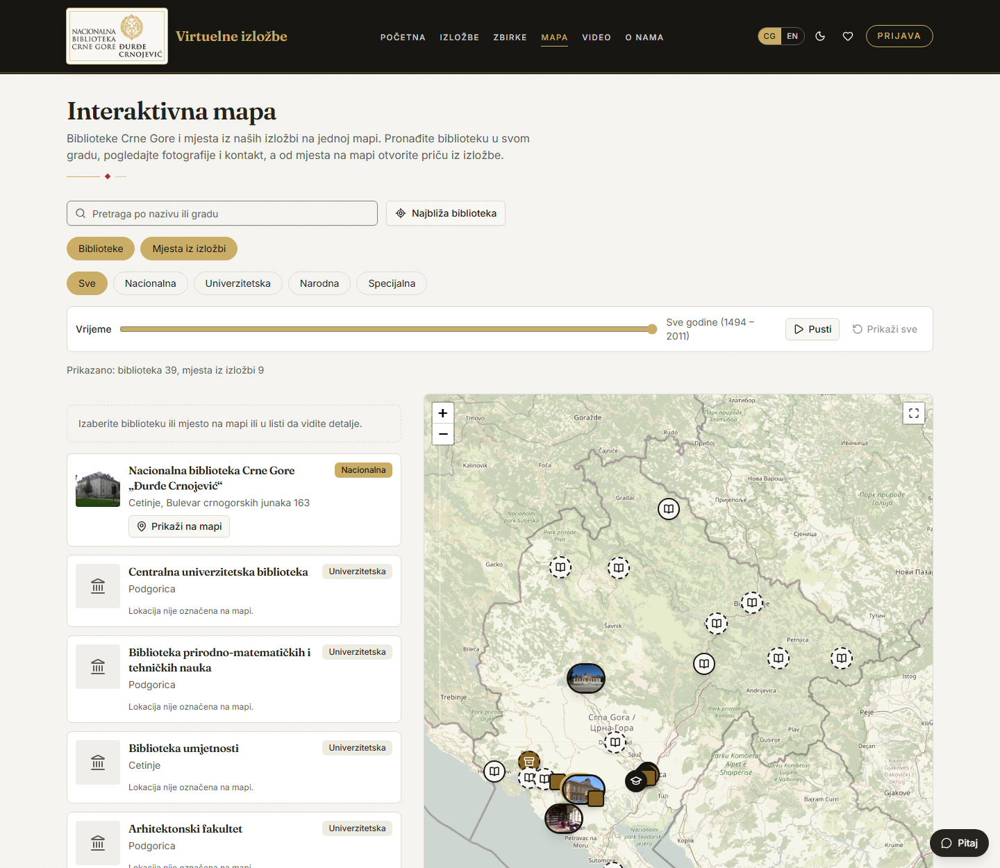
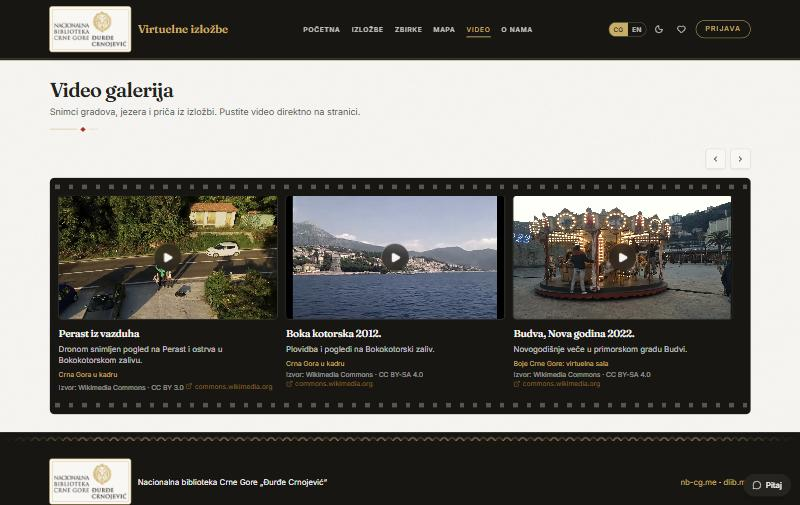

# Virtual Exhibitions of the National Library of Montenegro

[Crnogorska verzija (Montenegrin version)](README.me.md)

A bilingual (Montenegrin Latin script / English) platform where curators build interactive exhibitions from library collections and visitors explore them. Inspired by the virtual exhibition portals of national libraries, with a modern look and richer templates. Branded after [nb-cg.me](https://nb-cg.me) and linked to the digital library [dlib.me](https://dlib.me).

> Status: the **frontend** (AI-DEV 2026, Workshop 3) and the **backend** (Workshop 4: FastAPI, database, staff sign-in, server-side roles) are both in this repository. The frontend runs on mock data (`pnpm dev`) or on the backend (`pnpm dev:api`). The contract between them is in [`docs/entities.md`](docs/entities.md).

> **Notice:** this is an independent, educational demo project made for a workshop. It is **not** the official website of the National Library of Montenegro and is not affiliated with or endorsed by it. The library name and logo are used only for illustration, texts are illustrative, and the sample images and videos come from Wikimedia Commons.


## Highlights

- **Eight exhibition templates**: vertical timeline, masonry gallery with lightbox, map story, slider with before/after comparison, a walkable **3D hall**, a **page-turning book**, a **3D carousel** and a library **card catalogue**.
- **Video gallery** as a film strip, and videos inside exhibitions. A curator adds videos in the editor: a file, or just a YouTube or Vimeo link, which loads only when a visitor presses play (no third-party cookies before that).
- **Interactive map**: the libraries of Montenegro (with photos where a free one exists) and the places named in exhibitions on one map, framed on the country, on a calm base map. Each kind of library (national, university, public, special) has its own icon and a legend; search that ignores diacritics, a type filter, layers, "nearest library" with the distance to every library and the list sorted by it, "Directions" and "Copy link" on every card, and a click anywhere on a card selects it on the map. A **time slider** shows the places of the exhibitions as the story unfolds (it can play by itself), and a place opens the **numbered route** of its exhibition. On a phone the list and the map take turns. Sources: COBISS.CG statistics, OpenStreetMap and Wikimedia Commons.
- **Demo assistant** for visitors: answers questions about exhibitions, objects, libraries and how to use the site. It is a simulation: no AI service is called, it searches the site content and ready-made guides, so it costs nothing to run.
- **Exhibition check** for curators in the editor: a checklist (translations, summary, tags, sections, section texts, places for the map template, chronology for the timeline) and tag suggestions, also rule-based.
- **No accounts for visitors, two staff roles**: visitors browse and save favorites in their browser; curators build and submit exhibitions; admins publish them and manage accounts.
- **Serious exhibition pages**: a curator's introduction, facts about the exhibition, a ready-made citation, a "view as" switch between all eight viewers (a curator can turn it off for an exhibition), full screen, a printable PDF catalogue, related exhibitions, and object dialogs with zoom, extra catalogue details (shelf mark, language, material, dimensions) and a download button where the licence allows.
- **Bilingual UI and content** (Montenegrin Latin + English), light and dark theme, favorites, responsive from 375 px to 1440 px.
- **Libraries on the map and collections are data, not code**: an admin adds, edits and removes them (Administration), each library with its facts, a free photo with its credit, and the pin.
- **Media library**: curators upload pictures and videos with author and licence (Studio -> Media library) and pick the picture of an object in the exhibition editor; the type is checked from the file itself and the size is limited.
- **Editable site content (CMS)**: an admin edits 62 texts (the pages, the descriptions of the viewing modes, hints and the footer) in both languages (Administration -> Edit site content); visitors see the change at once, and "Restore default" brings the original back.
- **Account management**: an admin creates a staff account (name, email, role, first password), changes a role, switches an account off or on and sets a new password (Administration -> Users). A switched-off account is locked out at once, and an admin cannot demote or switch off their own account.
- **History of changes**: every creation, change and deletion of exhibitions (with each status move), site texts, libraries, collections, accounts and uploaded files is recorded with who and when (Administration -> History of changes). Passwords are never stored in it.
- **Share previews and search**: a shared link shows the exhibition's title, picture and description in Facebook, Viber and LinkedIn; the server also serves `sitemap.xml`, `robots.txt` and structured data (schema.org).
- **Fast to load**: every page loads on demand (the main bundle went from 895 kB to about 100 kB gzipped), and the 3D hall and the map load only when opened.
- **Accessible**: semantic HTML, labelled forms, visible focus, contrast above 4.5:1, reduced-motion friendly.
- **Clear feedback**: loading skeletons, a retry button when data fails to load, a confirmation or error message for every action, a confirmation dialog before deleting, and a notice when the connection drops.

| Timeline | Map story | 3D hall |
|---|---|---|
|  |  |  |

| Gallery | Before/after slider | Catalog |
|---|---|---|
|  |  |  |

| Page-turning book | 3D carousel | Card catalogue |
|---|---|---|
|  |  |  |

| Exhibition page (introduction, citation, view switch) |
|---|
|  |

| Curator studio (editor) | Admin | Phone (375 px) |
|---|---|---|
|  |  |  |

| Interactive map | Demo assistant | Editor check |
|---|---|---|
|  |  |  |

| Video gallery (film strip) |
|---|
|  |

## Workshop context

Built for **AI-DEV 2026, Workshop 3: Frontend in the AI era (from HTML to a React app)**, held on 17 October 2026 at Coinis Hub (Jovan Popović, Anja Pješivac, Stevan Čakić). The programme is co-financed by the Innovation Fund of Montenegro.

**Task:** build the frontend of an own app on mock data with Claude Code: 2 to 3 related entities, home, a list with a filter, a detail page, a create/update form and sign-in, responsive at 375 px and 1440 px, plus `docs/entities.md` for the backend.

**Delivered:** all of the above, extended with eight exhibition templates, a 3D hall, a video gallery, a bilingual UI and two staff roles. The backend of Workshop 4 is in `backend/` (see [`backend/README.md`](backend/README.md)).

## Run it

Requires Node 22+ and pnpm.

```bash
pnpm install
pnpm dev          # http://localhost:5173
pnpm typecheck && pnpm lint && pnpm build
```

### With the backend

Needs Python 3.13 and Poetry (details in [`backend/README.md`](backend/README.md)).

```bash
cd backend && poetry install && poetry run migrate && poetry run seed && poetry run start   # http://localhost:8000/docs
pnpm dev:api      # in another terminal: the same site, but data and sign-in come from the API
```

Backend checks (`cd backend`): `poetry run lint`, `poetry run typecheck`, `poetry run test` (172 tests) and `poetry run alembic check`. On every push GitHub Actions runs the backend checks and the frontend `typecheck`, `lint` and `build` (`.github/workflows/ci.yml`).

### Demo accounts (password `demo1234`)

| Role | Email | Can do |
|---|---|---|
| Curator | marko@nb-cg.me, nikola@nb-cg.me | create, edit, delete own exhibitions, submit for publishing |
| Admin | jelena@nb-cg.me | everything above plus publish or return exhibitions, manage accounts, edit site texts, libraries and collections, read the history of changes |

With `pnpm dev` data lives in memory and resets on reload; with `pnpm dev:api` it is stored in the backend database (`backend/data/app.db`). Favorites, language and theme are always kept in `localStorage`.

## What each role can do

| Role | Screens and actions |
|---|---|
| **Visitor** (no account) | Home, catalog with search and filters, exhibition viewers (timeline, gallery, map, slider, 3D hall, book, carousel, card catalogue), object details, video gallery, collections, About; save favorites; switch language and theme |
| **Curator** | Everything a visitor can, plus **Studio**: create an exhibition in two languages, add sections and objects, pick a template, save a draft, submit it for publishing, edit or delete own exhibitions |
| **Admin** | Everything a curator can, plus **Administration**: review queue (publish or return to draft), edit any exhibition, manage accounts, site texts, libraries and collections, history of changes |

The full list of screens with their "done when" criteria is in [`SPEC.md`](SPEC.md).

## Screens

| Route | Screen |
|---|---|
| `/` | Home: hero, featured exhibition, latest, templates, videos, collections |
| `/exhibitions` | Catalog with search and template filter (URL-synced) |
| `/exhibitions/:slug` | Exhibition viewer (template decides the layout) + videos |
| `/collections`, `/map`, `/videos`, `/about` | Collections of the digital library, interactive map, video gallery, about |
| `/favorites`, `/sign-in`, `/profile` | Saved exhibitions (kept in the browser), staff sign-in (lands on the page for your role), profile |
| `/studio`, `/studio/new`, `/studio/:id/edit` | Curator dashboard and exhibition editor (curator, admin) |
| `/studio/media` | Media library: upload pictures and videos with author and licence (curator, admin) |
| `/admin` | Review queue and accounts: create, change role, switch on or off, new password (admin) |
| `/admin/content`, `/admin/libraries`, `/admin/collections`, `/admin/history` | Edit site texts, libraries on the map, collections, and read the history of changes (admin) |

## Tech stack

React 19, TypeScript, Vite, Tailwind CSS v4, shadcn/ui, React Router, TanStack Query, React Hook Form + Zod, react-three-fiber (3D room), Leaflet (map). Fonts: Fraunces and Inter.

## Project structure

```
frontend/src/
  app/            router, providers, layout, thin route files (they only compose features)
  features/
    exhibitions/  types, api/ (mock + hooks), components/ (cards, viewers, editor)
    collections/  digital library collections
    libraries/    libraries of Montenegro for the interactive map: map, legend, time slider, cards
    content/      editable site texts (CMS)
    media/        media library: upload and pick pictures and videos
    audit/        history of changes (admin)
    assistant/    demo assistant: ready-made guides and the answer logic (no AI service)
    auth/         mock sign-in, roles, users
    favorites/    saved exhibitions
    about/        About page content
  components/     shared UI (shadcn/ui, image, reveal, ornament...)
  lib/            i18n, messages (me, en), theme, palette, mock-db
backend/app/      one folder per domain: auth, users, exhibitions, content, media, libraries, collections, audit, seo
docs/
  entities.md     entities and the API contract shared by frontend and backend
  screenshots/    images used in this README
.claude/          rules, commands, agents, skills and hooks for the AI agent (frontend and backend)
.github/          CI: backend and frontend checks on every push
```

Rules enforced by `pnpm lint`: a feature never imports another feature, shared code never imports features, data is only read through hooks that call the feature's `api/` folder.

## Where to look in the code

| File | What it shows |
|---|---|
| `frontend/src/app/router.tsx` | all routes and the role guards |
| `frontend/src/features/exhibitions/api/exhibitions-api.ts` | the only place that "fetches" data: picks the mock (`exhibitions-mock.ts`) or the backend (`exhibitions-http.ts`) |
| `backend/app/exhibitions/` | the exhibitions domain of the API: model, schemas, repository, service (the rules), endpoints |
| `backend/app/audit/`, `backend/app/seo/` | the history of changes (written by the other services in the same transaction) and the crawler pages (head tags, sitemap, robots) |
| `frontend/src/features/exhibitions/api/use-exhibitions.ts` | TanStack Query hooks around that API |
| `frontend/src/features/exhibitions/components/viewers/` | the eight templates (timeline, gallery, map, slider, 3D room, book, carousel, cards) |
| `frontend/src/features/auth/api/auth-api.ts` | demo users and session |
| `frontend/src/index.css` | design tokens for both themes |
| `frontend/src/lib/messages-me.ts`, `messages-en.ts` | all UI text in both languages |
| `frontend/scripts/check-boundaries.mjs` | the check that keeps features separate |
| `docs/entities.md` | entities and API contract for the backend |

## How it was built (AI-assisted workflow)

The repo follows the workshop workflow with Claude Code:

- [`CLAUDE.md`](CLAUDE.md) and [`frontend/CLAUDE.md`](frontend/CLAUDE.md): stack, commands, structure and the "done when" checklist.
- [`frontend/DESIGN.md`](frontend/DESIGN.md): tone, colors (tokens in `src/index.css`), fonts and the "avoid" list.
- [`.claude/rules`](.claude/rules): path-scoped rules for components, data, features, styling and i18n.
- [`.claude/commands`](.claude/commands) (`/check`, `/new-feature`, `/new-page`, and for the backend `/brief`, `/new-entity`, `/review-changes`, `/api-check`), the reviewer agents (`ui-reviewer`, `api-reviewer`, `contract-keeper`, `migration-reviewer`, `security-reviewer`), the skills (`design-system`, `backend-patterns`, `check-n1`, `test-endpoint`) and the hooks that block destructive commands and edits of secrets, lockfiles and committed migrations, format every edited file and run the Python checks when the agent finishes.
- [`backend/.claude`](backend/.claude): the backend's decisions (ADRs), rules and the log of frequent mistakes.
- [`SPEC.md`](SPEC.md): product spec (roles, screens, done-when, out of scope) and [`PLAN.md`](PLAN.md): plan and milestones.
- [`PROMPTS.md`](PROMPTS.md): the key prompts that shaped the project and the lessons learned.

Every change was checked with typecheck, lint and build, and pages were reviewed at 375 px and 1440 px.

## What is next

The API covers exhibitions, sign-in, account management, editable site content, media, libraries, collections, the history of changes and the pages for crawlers. Still open:

- **Going public**: a production setup (Docker, nginx with security headers and caching), a limit on sign-in attempts, removing the demo accounts, and moving the pictures and fonts to the library's own storage.
- **Metadata for aggregators** (Europeana and similar): standard rights statements instead of free text, and an export of the metadata.
- **A language in the address** (`/me/...`, `/en/...`), so that search engines see both versions.
- **Opening hours** of the libraries on the map, and automated tests for the frontend.

## Content and licences

Texts are illustrative. Sample images and videos come from [Wikimedia Commons](https://commons.wikimedia.org) under free licences (CC BY, CC BY-SA, public domain); the author and licence are shown with each object. The National Library name and logo are used from nb-cg.me for illustration in this educational demo only; this project is not official and is not affiliated with the library.
