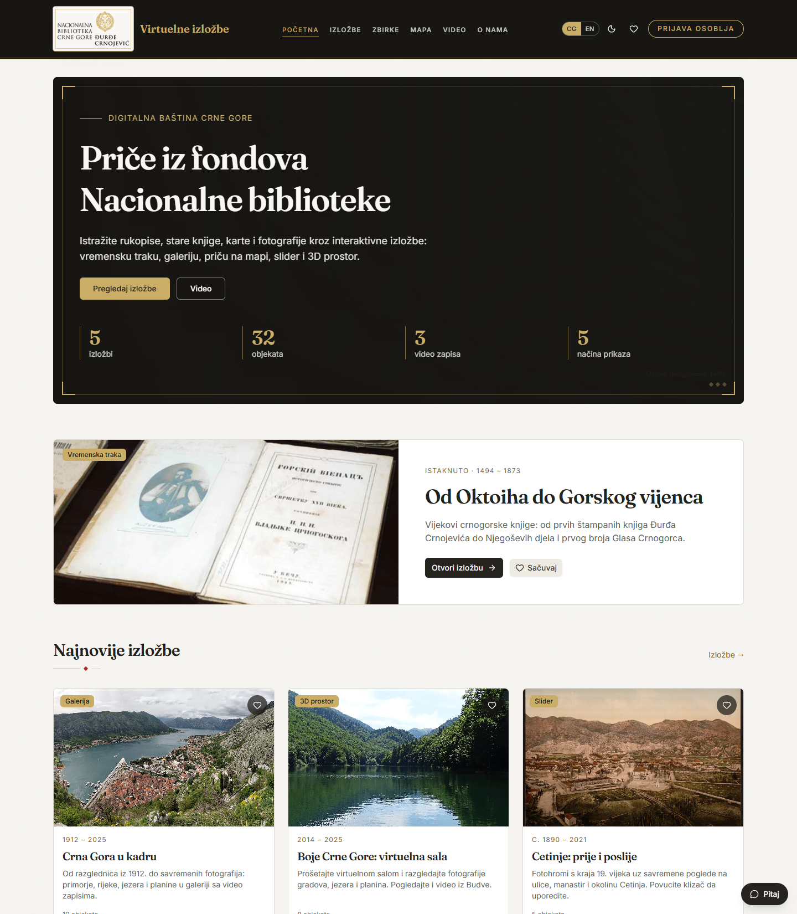
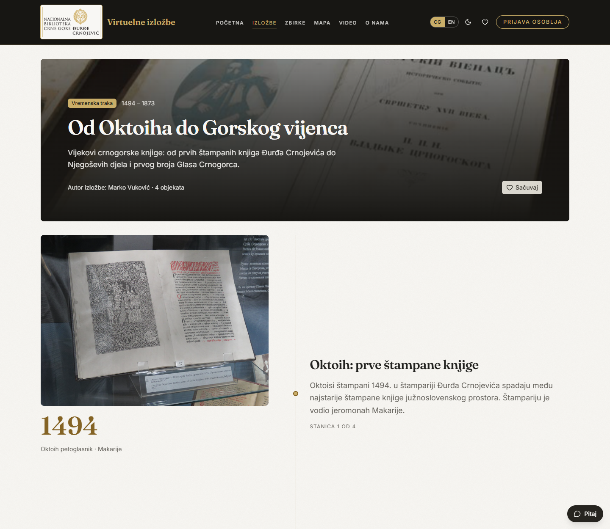
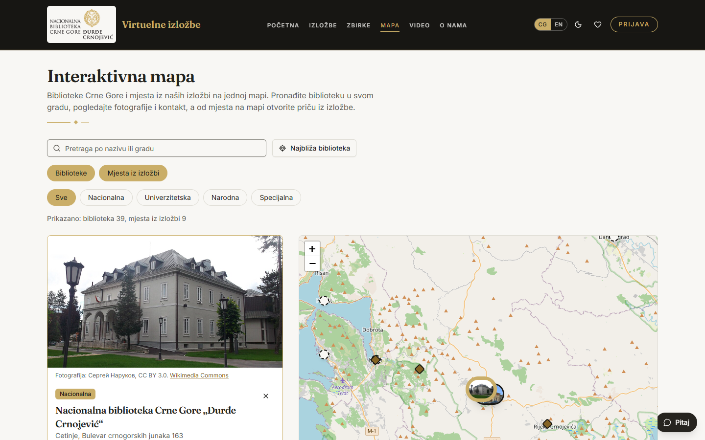
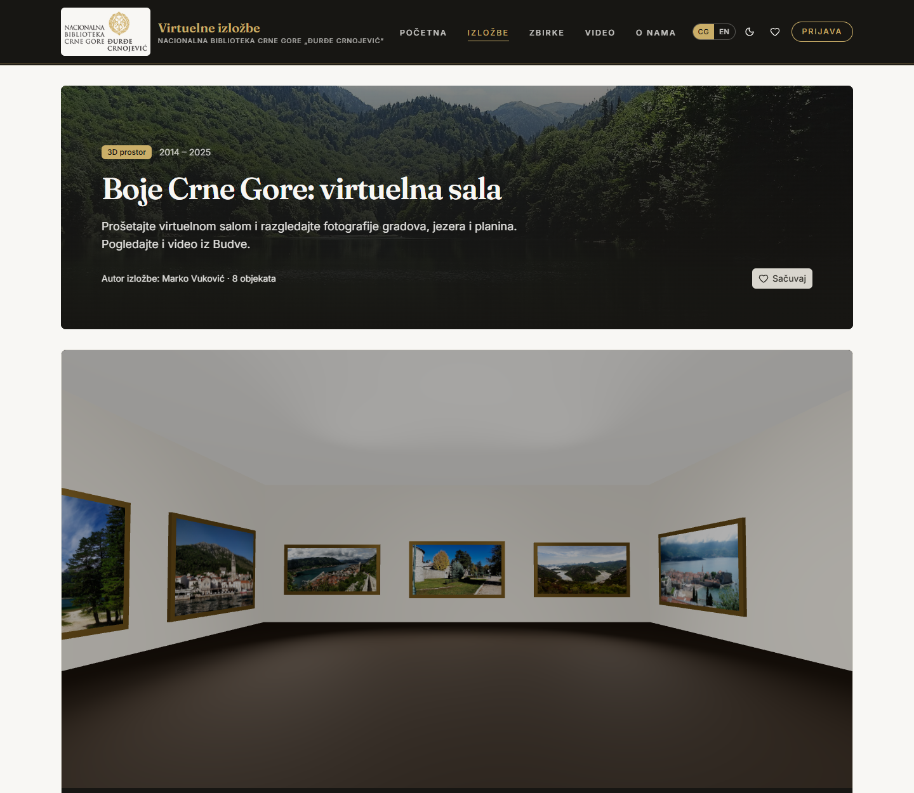
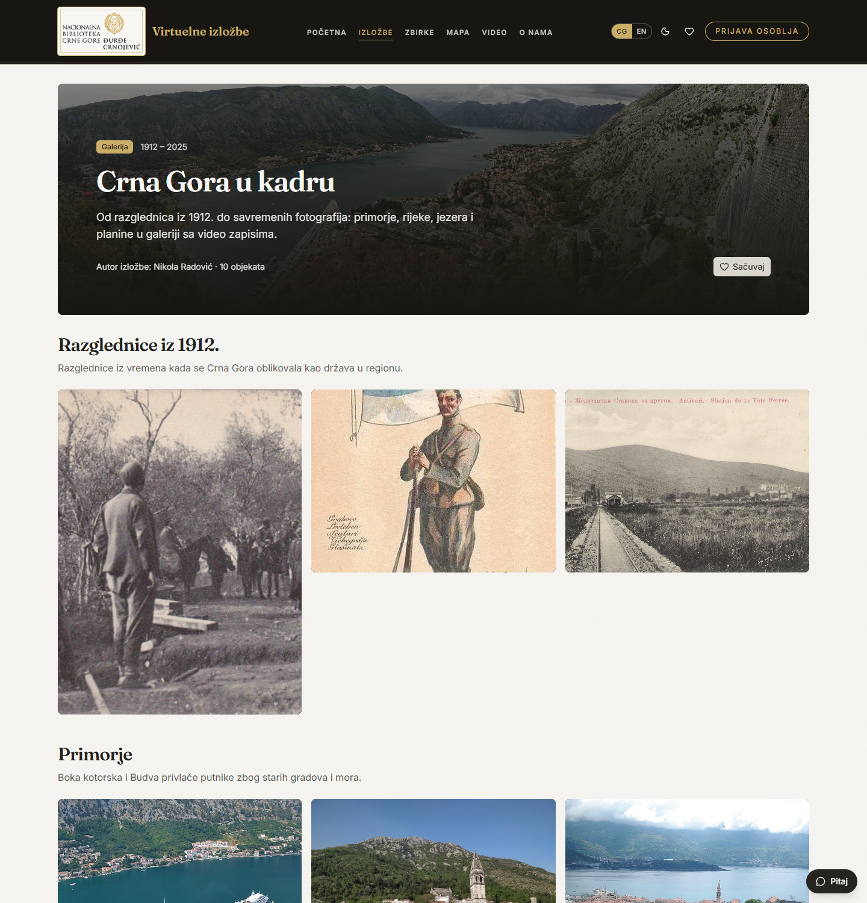
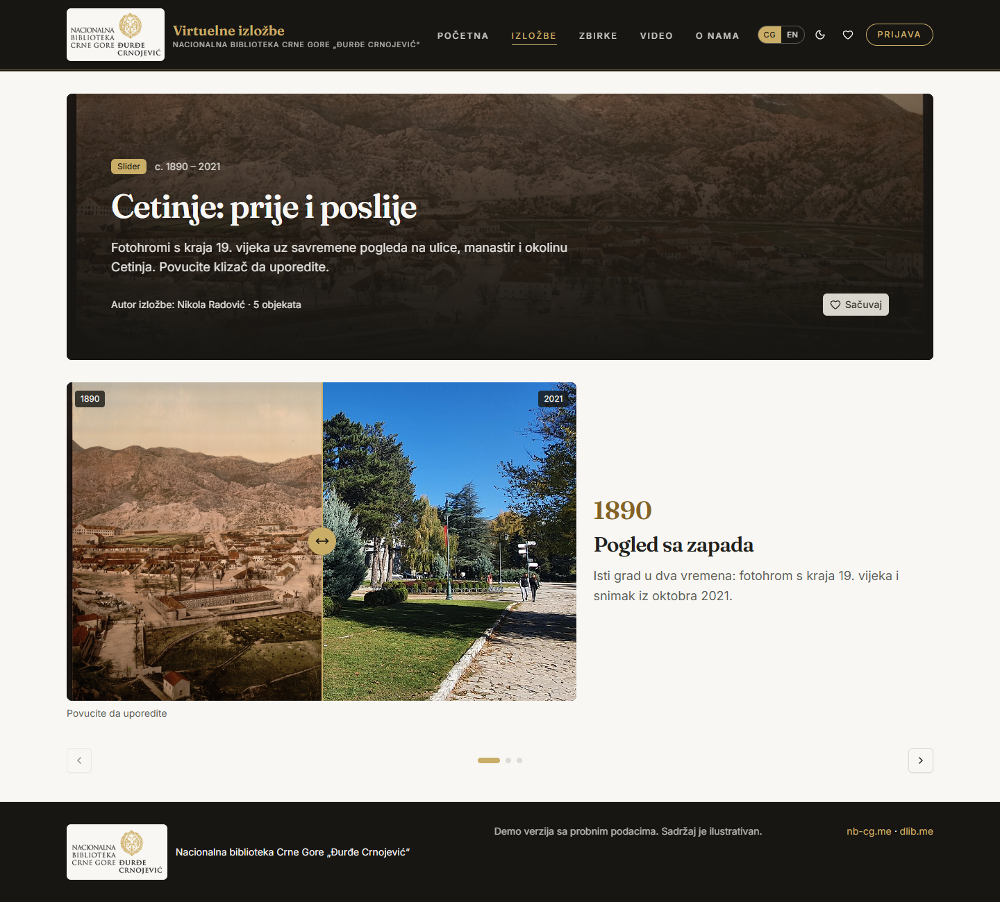
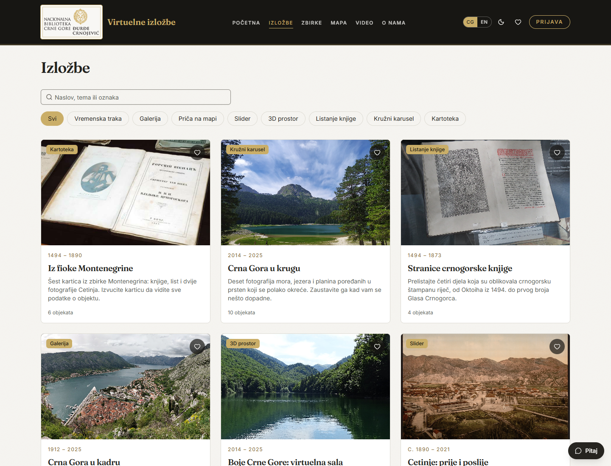
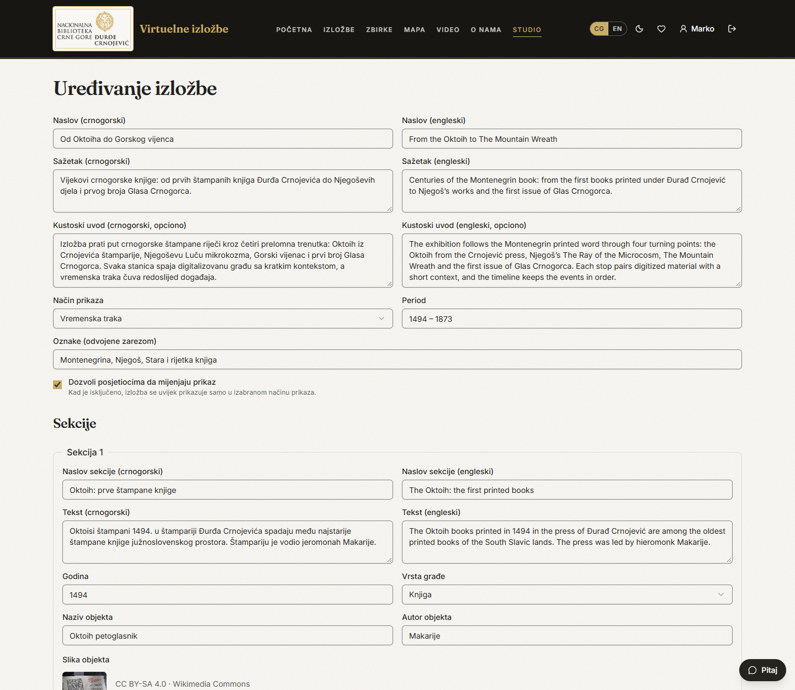
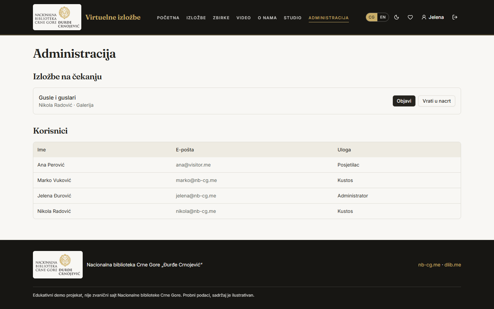
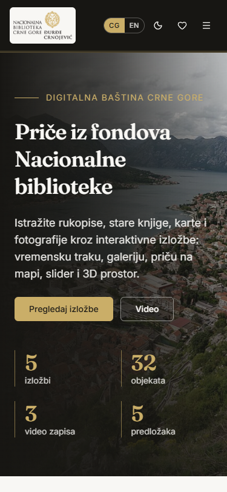

# Virtual Exhibitions of the National Library of Montenegro

[Crnogorska verzija (Montenegrin version)](README.me.md)

A bilingual (Montenegrin Latin script / English) platform where curators build interactive exhibitions from library collections and visitors explore them. Inspired by the virtual exhibition portals of national libraries, with a modern look and richer templates. Branded after [nb-cg.me](https://nb-cg.me) and linked to the digital library [dlib.me](https://dlib.me).

> Status: **frontend workshop (AI-DEV 2026, Workshop 3)** is done, running on mock data. The backend comes in Workshop 4. The contract between them is in [`docs/entities.md`](docs/entities.md).



## Highlights

- **Five exhibition templates**: vertical timeline, masonry gallery with lightbox, map story, slider with before/after comparison, and a walkable **3D hall**.
- **Video gallery** and videos inside exhibitions.
- **Three roles**: visitor, curator (builds and submits exhibitions), admin (publishes, manages users).
- **Bilingual UI and content** (Montenegrin Latin + English), light and dark theme, favorites, responsive from 375 px to 1440 px.
- **Accessible**: semantic HTML, labelled forms, visible focus, contrast above 4.5:1, reduced-motion friendly.

| Timeline | Map story | 3D hall |
|---|---|---|
|  |  |  |

| Gallery | Before/after slider | Catalog |
|---|---|---|
|  |  |  |

| Curator studio (editor) | Admin | Phone (375 px) |
|---|---|---|
|  |  |  |

## Workshop context

Built for **AI-DEV 2026, Workshop 3: Frontend in the AI era (from HTML to a React app)**, held on 17 October 2026 at Coinis Hub (Jovan Popović, Anja Pješivac, Stevan Čakić). The programme is co-financed by the Innovation Fund of Montenegro.

**Task:** build the frontend of an own app on mock data with Claude Code: 2 to 3 related entities, home, a list with a filter, a detail page, a create/update form and sign-in, responsive at 375 px and 1440 px, plus `docs/entities.md` for the backend.

**Delivered:** all of the above, extended with five exhibition templates, a 3D hall, a video gallery, a bilingual UI and three roles. The backend is planned for Workshop 4 (see [`backend/README.md`](backend/README.md)).

## Run it

Requires Node 22+ and pnpm.

```bash
pnpm install
pnpm dev          # http://localhost:5173
pnpm typecheck && pnpm lint && pnpm build
```

### Demo accounts (password `demo1234`)

| Role | Email | Can do |
|---|---|---|
| Visitor | ana@visitor.me | browse, save favorites |
| Curator | marko@nb-cg.me, nikola@nb-cg.me | create, edit, delete own exhibitions, submit for publishing |
| Admin | jelena@nb-cg.me | everything above plus publish or return exhibitions, list users |

Data lives in memory and resets on reload; favorites, language, theme and the demo session are kept in `localStorage`.

## What each role can do

| Role | Screens and actions |
|---|---|
| **Visitor** | Home, catalog with search and filters, exhibition viewers (timeline, gallery, map, slider, 3D hall), object details, video gallery, collections, About; save favorites; switch language and theme; after signing in, a profile page |
| **Curator** | Everything a visitor can, plus **Studio**: create an exhibition in two languages, add sections and objects, pick a template, save a draft, submit it for publishing, edit or delete own exhibitions |
| **Admin** | Everything a curator can, plus **Administration**: review queue (publish or return to draft), edit any exhibition, list users |

The full list of screens with their "done when" criteria is in [`SPEC.md`](SPEC.md).

## Screens

| Route | Screen |
|---|---|
| `/` | Home: hero, featured exhibition, latest, templates, videos, collections |
| `/exhibitions` | Catalog with search and template filter (URL-synced) |
| `/exhibitions/:slug` | Exhibition viewer (template decides the layout) + videos |
| `/collections`, `/videos`, `/about` | Collections of the digital library, video gallery, about |
| `/favorites`, `/sign-in`, `/profile` | Saved exhibitions, sign in (lands on the page for your role), profile |
| `/studio`, `/studio/new`, `/studio/:id/edit` | Curator dashboard and exhibition editor (curator, admin) |
| `/admin` | Review queue and users (admin) |

## Tech stack

React 19, TypeScript, Vite, Tailwind CSS v4, shadcn/ui, React Router, TanStack Query, React Hook Form + Zod, react-three-fiber (3D room), Leaflet (map). Fonts: Fraunces and Inter.

## Project structure

```
frontend/src/
  app/            router, providers, layout, thin route files (they only compose features)
  features/
    exhibitions/  types, api/ (mock + hooks), components/ (cards, viewers, editor)
    collections/  digital library collections
    auth/         mock sign-in, roles, users
    favorites/    saved exhibitions
    about/        About page content
  components/     shared UI (shadcn/ui, image, reveal, ornament...)
  lib/            i18n, messages (me, en), theme, palette, mock-db
docs/
  entities.md     entities and the API the frontend expects (for the backend)
  screenshots/    images used in this README
.claude/          rules, commands, subagent and skill for the AI agent
```

Rules enforced by `pnpm lint`: a feature never imports another feature, shared code never imports features, data is only read through hooks that call the feature's `api/` folder.

## How it was built (AI-assisted workflow)

The repo follows the workshop workflow with Claude Code:

- [`CLAUDE.md`](CLAUDE.md) and [`frontend/CLAUDE.md`](frontend/CLAUDE.md): stack, commands, structure and the "done when" checklist.
- [`frontend/DESIGN.md`](frontend/DESIGN.md): tone, colors (tokens in `src/index.css`), fonts and the "avoid" list.
- [`.claude/rules`](.claude/rules): path-scoped rules for components, data, features, styling and i18n.
- [`.claude/commands`](.claude/commands) (`/check`, `/new-feature`, `/new-page`), the `ui-reviewer` subagent and the `design-system` skill.
- [`SPEC.md`](SPEC.md): product spec (roles, screens, done-when, out of scope) and [`PLAN.md`](PLAN.md): plan and milestones.
- [`PROMPTS.md`](PROMPTS.md): the key prompts that shaped the project and the lessons learned.

Every change was checked with typecheck, lint and build, and pages were reviewed at 375 px and 1440 px.

## Next: backend (Workshop 4)

Replace the mock `api/` folders with real HTTP calls, add a database modelled after `docs/entities.md`, real authentication with server-side role checks, and file upload for images and videos. See [`backend/README.md`](backend/README.md).

## Content and licences

Texts are illustrative. Sample images and videos come from [Wikimedia Commons](https://commons.wikimedia.org) under free licences (CC BY, CC BY-SA, public domain); the author and licence are shown with each object. The National Library logo is used from nb-cg.me for this demo.
