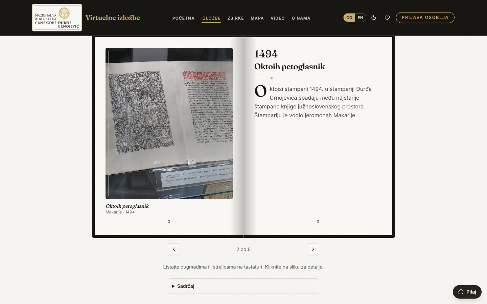
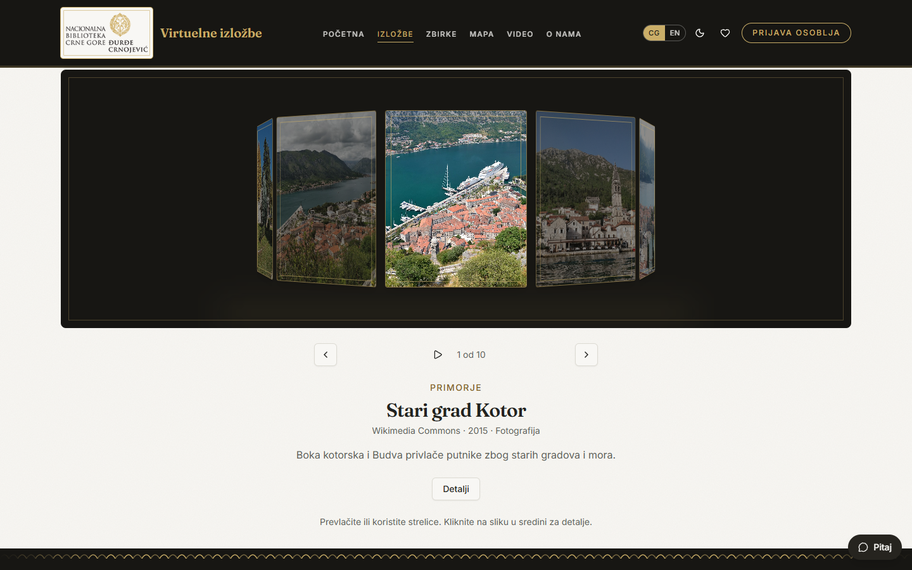
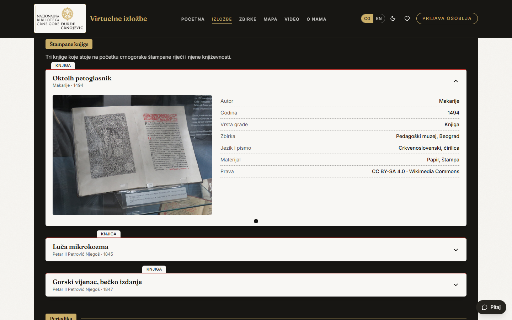
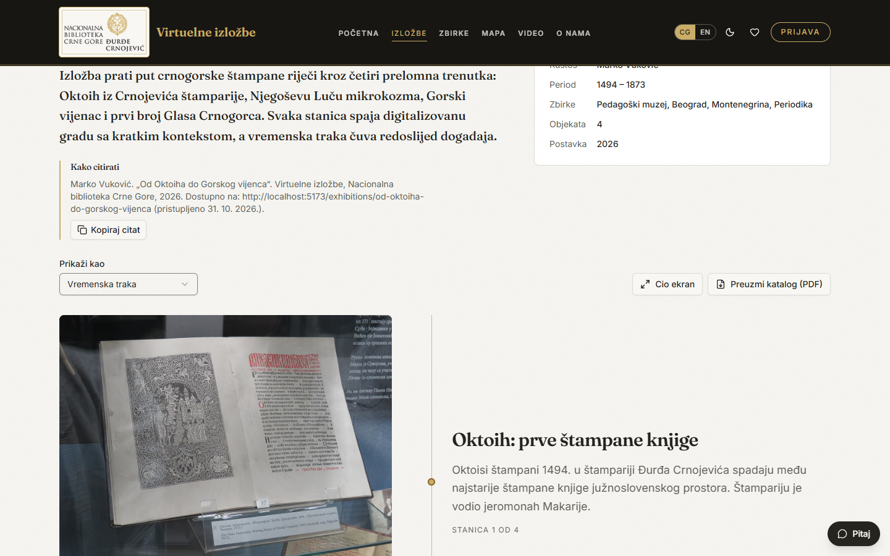
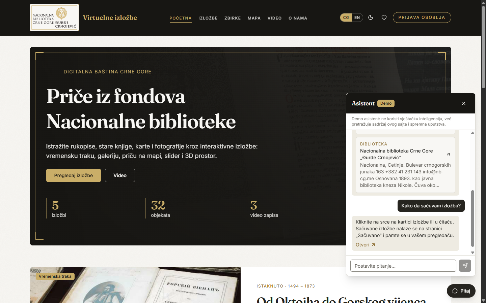
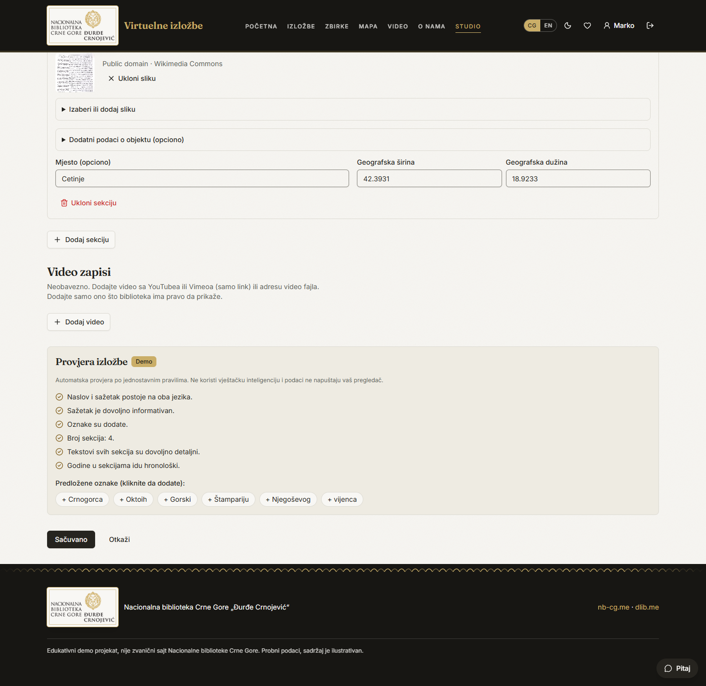

# Virtuelne izložbe Nacionalne biblioteke Crne Gore

[English version](README.md)

Dvojezična (crnogorski latinica / engleski) platforma na kojoj kustosi od digitalizovane građe prave interaktivne izložbe, a posjetioci ih razgledaju. Inspirisana portalima virtuelnih izložbi nacionalnih biblioteka, sa savremenim izgledom i bogatijim načinima prikaza. Vizuelni identitet je preuzet sa [nb-cg.me](https://nb-cg.me), a veza je i sa digitalnom bibliotekom [dlib.me](https://dlib.me).

> Stanje: završen je **frontend** (AI-DEV 2026, Radionica 3) na probnim (mock) podacima. Backend slijedi u Radionici 4. Ugovor između njih opisan je u [`docs/entities.md`](docs/entities.md).

> **Napomena:** ovo je samostalan, edukativni demo projekat nastao na radionici. **Nije** zvanični sajt Nacionalne biblioteke Crne Gore, niti je povezan sa njom ili odobren od nje. Naziv i logo biblioteke koriste se samo radi ilustracije, tekstovi su ilustrativni, a probne slike i video zapisi su sa Wikimedia Commons.


## Šta sajt nudi

- **Osam načina prikaza izložbi**: vremenska traka, galerija sa uvećanjem, priča na mapi, slider „prije i poslije“, **3D sala** po kojoj se može šetati, **knjiga čije se stranice listaju**, **3D karusel** i **kartoteka**.
- **Video galerija** i video zapisi unutar izložbi.
- **Interaktivna mapa**: biblioteke Crne Gore (sa fotografijama gdje postoji slobodna) i mjesta iz izložbi na jednoj mapi. Pretraga koja ne pravi razliku među dijakriticima, filter po vrsti, slojevi, dugme „Najbliža biblioteka“, kartice sa kontaktom i vezama, a od svakog mjesta veza ka izložbi. Izvori: statistika COBISS.CG, OpenStreetMap i Wikimedia Commons.
- **Demo asistent** za posjetioce: odgovara na pitanja o izložbama, objektima, bibliotekama i korišćenju sajta. To je simulacija: ne poziva nikakav AI servis, već pretražuje sadržaj sajta i spremna uputstva, pa ne troši resurse.
- **Provjera izložbe** za kustose u uređivaču: lista provjera (prevod, sažetak, oznake, sekcije, tekstovi, mjesta za mapu, hronologija za vremensku traku) i prijedlozi oznaka, takođe po jednostavnim pravilima.
- **Ozbiljnija stranica izložbe**: kustoski uvod, podaci o izložbi, gotov citat, prebacivanje između svih osam načina prikaza, cio ekran, katalog za štampu (PDF), slične izložbe i prozor objekta sa zumiranjem, dodatnim podacima (signatura, jezik, materijal, dimenzije) i dugmetom za preuzimanje tamo gdje licenca dozvoljava.
- **Bez naloga za posjetioce, dvije uloge osoblja**: posjetioci razgledaju izložbe i čuvaju omiljene u pregledaču; kustosi prave i šalju izložbe na objavu; administratori ih objavljuju i upravljaju korisnicima.
- Dvojezičan sadržaj, svijetla i tamna tema, sačuvane izložbe, prilagođen prikaz od 375 do 1440 px.
- Pristupačnost: semantički HTML, oznake na poljima, vidljiv fokus, kontrast iznad 4.5:1.
- Jasne poruke korisniku: prikaz učitavanja, dugme „Pokušaj ponovo“ pri grešci, potvrda ili upozorenje za svaku radnju, potvrda prije brisanja i obavještenje kad se prekine veza.

| Vremenska traka | Priča na mapi | 3D sala |
|---|---|---|
|  |  |  |

| Galerija | Slider „prije i poslije“ | Katalog |
|---|---|---|
|  |  |  |

| Listanje knjige | 3D karusel | Kartoteka |
|---|---|---|
|  |  |  |

| Stranica izložbe (uvod, citat, prebacivanje prikaza) |
|---|
|  |

| Studio za kustosa (uređivač) | Administracija | Telefon (375 px) |
|---|---|---|
|  |  |  |

| Interaktivna mapa | Demo asistent | Provjera izložbe |
|---|---|---|
|  |  |  |

## Kontekst radionice

Napravljeno za **AI-DEV 2026, Radionica 3: Frontend u AI eri (od HTML-a do React aplikacije)**, održanu 17. oktobra 2026. u Coinis Hubu (Jovan Popović, Anja Pješivac, Stevan Čakić). Program je sufinansiran iz Fonda za inovacije Crne Gore.

**Zadatak:** napraviti frontend sopstvene aplikacije na probnim podacima uz Claude Code: 2 do 3 povezana entiteta, početna, lista sa filterom, stranica sa detaljima, forma za pravljenje i izmjenu i prijava, prilagođeno za 375 i 1440 px, uz `docs/entities.md` za backend.

**Urađeno:** sve navedeno, uz osam načina prikaza izložbi, 3D salu, video galeriju, dvojezični interfejs i dvije uloge osoblja. Backend je planiran za Radionicu 4 (vidi [`backend/README.md`](backend/README.md)).

## Pokretanje

Potrebni su Node 22+ i pnpm.

```bash
pnpm install
pnpm dev          # http://localhost:5173
pnpm typecheck && pnpm lint && pnpm build
```

### Demo nalozi (lozinka `demo1234`)

| Uloga | E-pošta | Šta može |
|---|---|---|
| Kustos | marko@nb-cg.me, nikola@nb-cg.me | pravljenje, izmjena i brisanje sopstvenih izložbi, slanje na objavu |
| Administrator | jelena@nb-cg.me | sve navedeno, plus objava ili vraćanje izložbi i lista korisnika |

Podaci su u memoriji i vraćaju se na početno stanje pri osvježavanju stranice. Jezik, tema, sačuvane izložbe i prijava čuvaju se u pregledaču.

## Šta koja uloga može

| Uloga | Ekrani i radnje |
|---|---|
| **Posjetilac** (bez naloga) | Početna, katalog sa pretragom i filterima, čitači izložbi, detalji objekata, video galerija, zbirke, O nama; čuvanje izložbi; promjena jezika i teme |
| **Kustos** | Sve što i posjetilac, plus **Studio**: pravljenje izložbe na dva jezika, sekcije i objekti, izbor načina prikaza, čuvanje nacrta, slanje na objavu, izmjena i brisanje sopstvenih izložbi |
| **Administrator** | Sve što i kustos, plus **Administracija**: red izložbi na čekanju (objavi ili vrati u nacrt), izmjena svake izložbe, lista korisnika |

Potpuna lista ekrana sa kriterijumima „gotovo je kad“ nalazi se u [`SPEC.md`](SPEC.md) (na engleskom).

## Ekrani

| Ruta | Ekran |
|---|---|
| `/` | Početna: hero, istaknuta izložba, najnovije, načini prikaza, video zapisi, zbirke |
| `/exhibitions` | Katalog sa pretragom i filterom po načinu prikaza (čuvaju se u adresi) |
| `/exhibitions/:slug` | Čitač izložbe (način prikaza određuje raspored) i video zapisi |
| `/collections`, `/map`, `/videos`, `/about` | Zbirke, interaktivna mapa, video galerija, O nama |
| `/favorites`, `/sign-in`, `/profile` | Sačuvano (pamti se u pregledaču), prijava osoblja (vodi na stranicu za tvoju ulogu), profil |
| `/studio`, `/studio/new`, `/studio/:id/edit` | Pregled i uređivač izložbi (kustos, admin) |
| `/admin` | Red za objavu i korisnici (admin) |

## Struktura projekta

```
frontend/src/
  app/            ruter, provajderi, raspored, tanki fajlovi ruta (samo sklapaju funkcionalnosti)
  features/
    exhibitions/  tipovi, api/ (probni podaci + hookovi), components/ (kartice, čitači, uređivač)
    collections/  zbirke digitalne biblioteke
    libraries/    biblioteke Crne Gore za interaktivnu mapu (probni podaci, izvori u kodu)
    assistant/    demo asistent: spremna uputstva i logika odgovora (bez AI servisa)
    auth/         probna prijava, uloge, korisnici
    favorites/    sačuvane izložbe
    about/        sadržaj stranice O nama
  components/     dijeljeni UI (shadcn/ui, slika, reveal, ornament...)
  lib/            i18n, tekstovi (me, en), tema, paleta, mock-db
docs/
  entities.md     entiteti i API koji frontend očekuje (za backend)
  screenshots/    slike korišćene u ovom README-u
.claude/          pravila, komande, subagent i skill za AI agenta
```

Pravila koja provjerava `pnpm lint`: funkcionalnost nikad ne uvozi drugu funkcionalnost, dijeljeni kod ne uvozi funkcionalnosti, a podaci se čitaju samo kroz hookove koji pozivaju `api/` folder te funkcionalnosti.

## Gdje u kodu

Rute i uloge: `frontend/src/app/router.tsx`. Podaci (probni, zamjenjuje ih backend): `frontend/src/features/exhibitions/api/exhibitions-api.ts` i `use-exhibitions.ts`. Sedam načina prikaza: `frontend/src/features/exhibitions/components/viewers/`. Boje i teme: `frontend/src/index.css`. Tekstovi na oba jezika: `frontend/src/lib/messages-me.ts` i `messages-en.ts`. Ugovor sa backendom: `docs/entities.md`.

## Tehnologije

React 19, TypeScript, Vite, Tailwind CSS v4, shadcn/ui, React Router, TanStack Query, React Hook Form + Zod, react-three-fiber (3D sala), Leaflet (mapa). Fontovi: Fraunces i Inter.

## Kako je rađeno

Projekat prati tok rada radionice sa Claude Code agentom:

- [`CLAUDE.md`](CLAUDE.md) i [`frontend/CLAUDE.md`](frontend/CLAUDE.md): tehnologije, komande, struktura i lista „gotovo je kad“.
- [`frontend/DESIGN.md`](frontend/DESIGN.md): ton, boje (tokeni u `src/index.css`), fontovi i lista šta izbjegavati.
- [`.claude/rules`](.claude/rules): pravila po putanjama za komponente, podatke, funkcionalnosti, stilove i i18n.
- [`.claude/commands`](.claude/commands) (`/check`, `/new-feature`, `/new-page`), subagent `ui-reviewer` i skill `design-system`.
- [`SPEC.md`](SPEC.md): specifikacija proizvoda (uloge, ekrani, „gotovo je kad“, van obima) i [`PLAN.md`](PLAN.md): plan i etape.
- [`PROMPTS.md`](PROMPTS.md): ključni zahtjevi koji su oblikovali projekat i zaključci.

Svaka izmjena provjerena je komandama `typecheck`, `lint` i `build`, a ekrani pregledani na 375 i 1440 px. Dokumentacija i kod su na engleskom, a tekst u aplikaciji je dvojezičan.

## Sljedeće: backend (Radionica 4)

Mock `api/` folderi zamjenjuju se pravim HTTP pozivima, uz bazu po `docs/entities.md`, pravu prijavu sa provjerom uloga na serveru i otpremanje slika i videa. Plan je u [`backend/README.md`](backend/README.md).

## Sadržaj i licence

Tekstovi su ilustrativni. Probne slike i video zapisi su sa [Wikimedia Commons](https://commons.wikimedia.org) pod slobodnim licencama (CC BY, CC BY-SA, javno dobro); autor i licenca prikazani su uz svaki objekat. Naziv i logo Nacionalne biblioteke preuzeti su sa nb-cg.me isključivo radi ilustracije u ovom edukativnom demou; projekat nije zvaničan i nije povezan sa bibliotekom.
